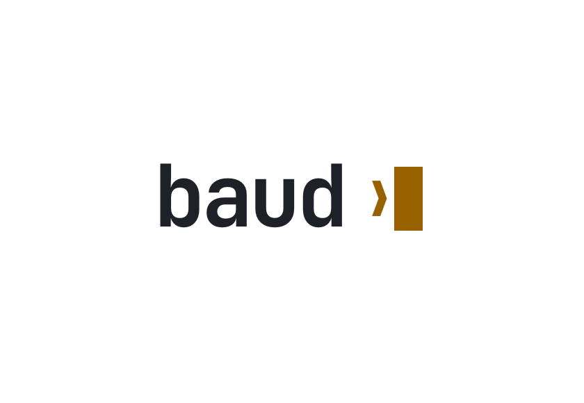

<div align="center">

<picture>
  <source media="(prefers-color-scheme: dark)" srcset="assets/readme/logo-dark.gif">
  
</picture>

**The terminal with character: its own font, its own cursor effects, and the speed to keep up.**

[Install](#install) · [Features](docs/guide/features.md) · [Configuration](docs/guide/configuration.md) · [Roadmap](docs/roadmap.md) · [Documentation](docs/README.md)


</div>

A baud is one symbol a second down a line, named for Émile Baudot, whose
1874 code sent text over the telegraph one symbol at a time. That is still
the job: every character a program sends, on your screen, drawn right and
in time. baud does it with a look of its own.

**Status:** baud runs as an everyday terminal on macOS 26 and later, and
the Linux version is in progress. [What works today, and what doesn't yet](docs/guide/status.md).

**[See all 212 features](docs/guide/features.md)** · **[See the roadmap](docs/roadmap.md)**

## Install

baud runs on macOS 26 and later, and installs with
[Nix](https://nixos.org) (with flakes turned on). One command fetches the
exact compiler, builds baud with the settings it is measured with -- the
`baud` command, and on a Mac the app, `baud.app` -- and opens it: a
window running your login shell.

```sh
nix run github:baud-terminal/baud            # or: nix profile add github:baud-terminal/baud
```

baud's licence, CC BY-NC-SA 4.0, lets you use it for anything that is not
commercial. nixpkgs counts that as unfree, so if you build baud in your own
nixpkgs through this flake's `overlays.default`, allow it there:
`nixpkgs.config.allowUnfreePredicate = pkg: lib.getName pkg == "baud";`.

There is no release yet, so Nix is the one way to install baud for now.
[Installing](docs/guide/install.md) has the details, and where the app
for Applications and the Dock is.

baud needs no configuration. To change the font, colours, cursor or window,
copy [config.toml.example](config.toml.example) to
`~/.config/baud/config.toml` and keep only the keys you change;
[Configuration](docs/guide/configuration.md) lists every key.

## Proved, not promised

baud follows the standards terminals answer to: ECMA-48, DEC's terminal
manuals, xterm's control sequences and the Unicode Standard. Every built
feature on the list names the test, coverage row or measurement that
proves it, and the build fails if that proof disappears. What of each standard is
done, and why anything is not, is a row per operation in
[the coverage table](docs/vt-coverage.md).

Its terminal core is a separate library any program can embed:
[Embedding](docs/embedding.md).

## Contributing

[docs/README.md](docs/README.md) is the index of every document, and the
[code of conduct](CODE_OF_CONDUCT.md) says how contributors treat each
other. `cargo test`, `cargo nextest run`, `cargo bench` and `cargo run` start
their binary under a memory bound, [`scripts/bounded`](scripts/bounded), which
kills a runaway before the machine has to choose what else to kill, at the size
[`budgets.toml`](budgets.toml) holds; a harness
that starts cargo or a test binary itself, such as a mutation run in a copied
tree the runner cannot reach, calls `scripts/bounded --timeout SECS -- COMMAND...`,
because a timeout on cargo alone leaves the test binary under it running.

## Credits

baud is built on other people's work. [THIRD_PARTY.md](THIRD_PARTY.md)
lists every file with its licence and where it came from; each licence
text sits beside the files it covers or in [LICENSES/](LICENSES/).

**The fonts baud ships**

- [JetBrains Mono](https://github.com/JetBrains/JetBrainsMono), by The
  JetBrains Mono Project Authors (SIL OFL 1.1): the default face, and the
  base of baud's own font.
- [Cascadia Mono](https://github.com/microsoft/cascadia-code), by Microsoft
  (SIL OFL 1.1): the Hebrew in baud's own font is drawn from it.
- [STIX Two Math](https://github.com/stipub/stixfonts), by The STIX Fonts
  Project Authors (SIL OFL 1.1).
- [Symbols Nerd Font](https://github.com/ryanoasis/nerd-fonts), by Ryan L
  McIntyre and the Nerd Fonts contributors (MIT), with the icon sets it
  carries under their own licences.

**Code and data baud carries**

- [xterm](https://invisible-island.net/xterm/), by Thomas E. Dickey (X11):
  the national replacement character sets, the XTGETTCAP names and the
  readline click's arithmetic.
- [libX11](https://gitlab.freedesktop.org/xorg/lib/libx11)'s Xcms, by
  Tektronix and The Open Group, and X.Org's colour names (MIT).
- [libxkbcommon](https://github.com/xkbcommon/libxkbcommon) (MIT): the
  Compose reader and the keysym table.
- [Björn Ottosson](https://bottosson.github.io/posts/oklab/)'s OKLab
  conversions (MIT).
- The [Unicode Character Database](https://www.unicode.org/ucd/), by Unicode,
  Inc. (Unicode License v3): widths, grapheme clusters and the character
  sets.
- [ncurses](https://invisible-island.net/ncurses/)'s xterm-256color entry
  (X11).
- [Windows Terminal](https://github.com/microsoft/terminal), by Microsoft
  (MIT): four text-gamma coefficients.
- [kitty](https://github.com/kovidgoyal/kitty), by Kovid Goyal: the Unicode
  placeholder table its graphics protocol defines.
- [foot](https://codeberg.org/dnkl/foot), by Daniel Eklöf (MIT): the DEC
  Special Graphics table.
- sfte, by Patryk Pujanek (zlib): a test helper.
- This software is based in part on the work of the Independent JPEG Group.

**Pictures in this README**

- Wallpapers from [elementary OS](https://elementary.io) (CC0), and Noto
  Color Emoji and Noto Sans CJK by Google (SIL OFL 1.1).

## Licence

baud is free to use for anything that is not commercial, under Creative
Commons Attribution-NonCommercial-ShareAlike 4.0 International (CC BY-NC-SA
4.0); see [LICENSE](LICENSE). The fonts and the
third-party files the research and tests hold are under their own licences:
LICENSE names the files it does not cover, and
[THIRD_PARTY.md](THIRD_PARTY.md) lists each with its licence and source.
[Licensing](docs/guide/licensing.md) covers sponsorship and how to arrange a
commercial licence.
