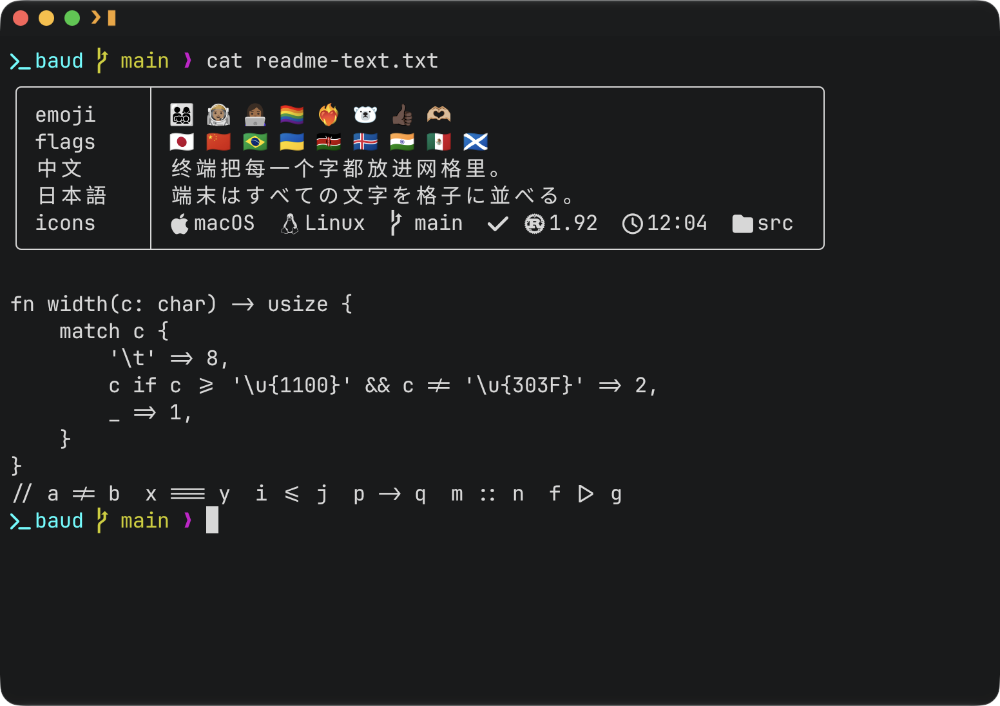
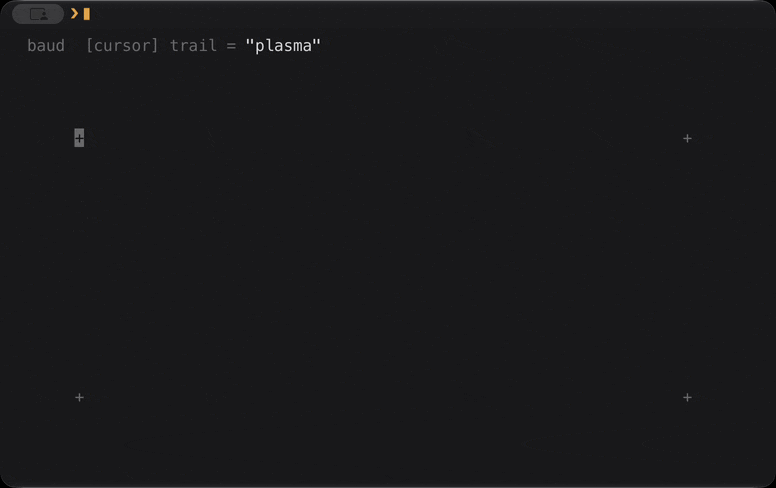
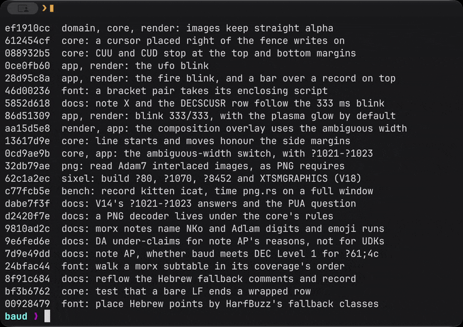
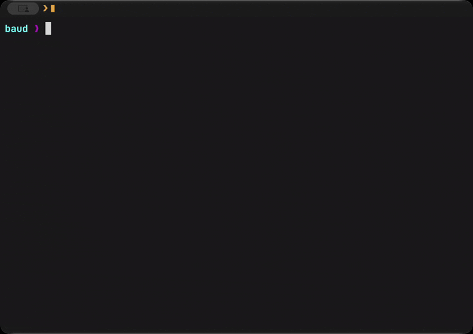

<div align="center">

<picture>
  <source media="(prefers-color-scheme: dark)" srcset="assets/logo/baud-lockup-dark-blinking.svg">
  
</picture>

**The terminal with character: its own font, its own cursor effects, and the speed to keep up.**

[Install](#install) · [Features](docs/guide/features.md) · [Configuration](docs/guide/configuration.md) · [Roadmap](docs/roadmap.md) · [Documentation](docs/README.md)


</div>

A baud is one symbol a second down a line, named for Émile Baudot, whose
1874 code sent text over the telegraph one symbol at a time. That is still
the job: every character a program sends, on your screen, drawn right and
in time. baud does it with a look of its own.

**Status:** baud runs as an everyday terminal on macOS 26 and later, and
the Linux version is in progress. [What works today, and what doesn't yet](docs/guide/status.md).

## Highlights

### The baud font

baud ships with its own font, so text looks right on the first launch with
nothing to install: JetBrains Mono with its ligatures and real bold and
italic faces, the Nerd Font icons prompts and file managers draw, a maths
face for technical symbols, and glyphs baud draws itself where JetBrains
Mono has none, such as a monospace Hebrew made to match it. Bring your own
fonts and the baud font stays behind them, filling in what they lack.



<sub>The emoji, Chinese and Japanese in this picture are Noto Color Emoji
and Noto Sans CJK, named for the shot. The baud font has neither; by
default baud uses your system's emoji and CJK fonts.</sub>

### A cursor with character

When the cursor jumps, it can leave a short trail: plasma, fire,
lightning, ice, a flying saucer and more. While it blinks off it can
glow, fade or burn into embers. Typing never leaves a trail, the fiery
ones never strobe, and with Reduce Motion on there is no trail unless you
ask for one.
[See every effect in the cursor gallery](docs/cursor.md).



### Keeps up with any output

A huge log, btop redrawing the whole screen, a build flooding past: baud
takes output in as fast as programs send it, without falling behind. A
key you press during the flood is drawn at once, and a program that
redraws in one go never shows you a half-finished screen.
[How fast, and how it is measured](docs/guide/performance.md).

### Text you can read

Text too close in colour to its background is lifted to a readable
contrast, keeping its hue, while colours a program chose on purpose are
left alone. Smoothing suits the colour text is drawn in, so light on dark
and dark on light both read cleanly, and on macOS the light and dark
palettes follow your system's appearance.

### Characters line up

Widths come from Unicode's own data, so Chinese, Japanese and Korean take
two columns, an emoji family or a flag stays one character, and a
ligature takes exactly the cells it replaces. Tables, prompts and editors
stay aligned, as the right-hand border in the picture above shows.
Box-drawing lines join without hairline gaps at every size.

### Safe by default

A broken or cut-off escape code is thrown away, never half-obeyed. A
giant title or link is cut to size, so it can't fill memory. No program
can read your clipboard, and a broken font file can't crash the terminal.
A question baud can't answer truthfully gets no reply rather than a wrong
one.

### And what you would expect

Scroll back through the history with the wheel, select across it, and
resize: lines rewrap to the new width.



Pictures show in the terminal, through tmux too: the kitty graphics
protocol and Sixel are both supported. Tools that ask first whether the
terminal draws pictures, such as yazi and plain `kitten icat`, need one
setting turned on ([how](docs/guide/configuration.md#images)).



**[See all 150 features](docs/guide/features.md)** · **[See the roadmap](docs/roadmap.md)**

## Install

**With Nix or Cargo, once published.** baud is not on a package registry
yet; Nix and Cargo packages are planned for the first published release.

**From source, today.** With [Nix](https://nixos.org) and
[devenv](https://devenv.sh), which fetch the exact toolchain:

```sh
devenv shell -- scripts/bundle-macos.sh   # leaves baud.app in target/
devenv shell -- cargo run --release       # or run it from the terminal you are in
```

[Installing](docs/guide/install.md) has the details.

baud needs no configuration. To change the font, colours, cursor or window,
copy [config.toml.example](config.toml.example) to
`~/.config/baud/config.toml` and keep only the keys you change;
[Configuration](docs/guide/configuration.md) lists every key.

## Proved, not promised

baud follows the standards terminals answer to: ECMA-48, DEC's terminal
manuals, xterm's control sequences and the Unicode Standard. Every built
feature on the list names the test, coverage row or measurement that
proves it, and the build fails if that proof disappears. What of each standard is
done, and why anything is not, is a row per operation in
[the coverage table](docs/vt-coverage.md).

Its terminal core is a separate library any program can embed:
[Embedding](docs/embedding.md).

## Contributing

[CONTRIBUTING.md](CONTRIBUTING.md) says what a change needs, and
[docs/contributing/build.md](docs/contributing/build.md) has the test suites
and the gates. [docs/README.md](docs/README.md) is the index of every
document.

## Licence

baud is open source under Creative Commons Attribution-NonCommercial-ShareAlike
4.0 International (CC BY-NC-SA 4.0); see [LICENSE](LICENSE). The fonts and the
third-party files the research and tests hold are under their own licences:
LICENSE names the files it does not cover, and
[THIRD_PARTY.md](THIRD_PARTY.md) lists each with its licence and source.
[Licensing](docs/guide/licensing.md) covers sponsorship and how to arrange a
commercial licence.
