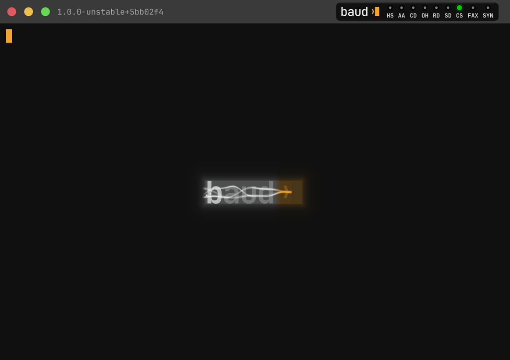

<div align="center">

<picture>
  <source media="(prefers-reduced-motion: reduce) and (prefers-color-scheme: dark)" srcset="assets/logo/baud-lockup-dark-tight.svg">
  <source media="(prefers-reduced-motion: reduce)" srcset="assets/logo/baud-lockup-light-tight.svg">
  <source media="(prefers-color-scheme: dark)" srcset="assets/readme/logo-dark.gif">
  
</picture>

**The terminal with character.**

[Install](#install) · [Features](docs/guide/features.md) · [Configuration](docs/guide/configuration.md) · [Roadmap](docs/roadmap.md) · [Documentation](docs/README.md)

[](https://nixos.org)
[](https://devenv.sh)
[](#install)
[](#install)
[](LICENSE)



</div>

A baud is one symbol a second down a line, named for Émile Baudot, whose
1874 code sent text over the telegraph one symbol at a time. That is still
the job: every character a program sends, on your screen, drawn right and
in time. baud does it with a look of its own.

**Status:** baud runs as an everyday terminal on macOS 26 and later, and
the Linux version is in progress. [What works today, and what doesn't yet](docs/guide/status.md).

**[See all 219 features](docs/guide/features.md)** · **[See the roadmap](docs/roadmap.md)**

## Install

baud runs on macOS 26 and later, and installs with
[Nix](https://nixos.org) (with flakes turned on). One command fetches the
exact compiler, builds baud with the settings it is measured with -- the
`baud` command, and on a Mac the app, `baud.app` -- and opens it: a
window running your login shell.

```sh
nix run github:baud-terminal/baud            # or: nix profile add github:baud-terminal/baud
```

[Installing](docs/guide/install.md) has the details, including the app for
Applications and the Dock, and building baud in your own nixpkgs.

baud needs no configuration. The first time it starts and finds none, it
writes `~/.config/baud/config.toml` (under `$XDG_CONFIG_HOME` when that is
set) with every setting commented out and explained; take the `#` off a
line to change it.
[Configuration](docs/guide/configuration.md) lists every key.

`baud --credits` prints the notices of the fonts, icons, data and ported
code the program carries, with their licences; on a Mac, the About window's
Acknowledgements link opens the same notices in
[THIRD_PARTY.md](THIRD_PARTY.md).

## Proved, not promised

baud follows the standards terminals answer to: ECMA-48, DEC's terminal
manuals, xterm's control sequences and the Unicode Standard. Every built
feature on the list names the test, coverage row or measurement that
proves it, and the build fails if that proof disappears. What of each standard is
done, and why anything is not, is a row per operation in
[the coverage table](docs/vt-coverage.md).

Its terminal core is a separate library any program can embed:
[Embedding](docs/embedding.md).

## Contributing

[docs/README.md](docs/README.md) is the index of every document, and the
[code of conduct](CODE_OF_CONDUCT.md) says how contributors treat each
other. `cargo test`, `cargo nextest run`, `cargo bench` and `cargo run` start
their binary under a memory bound, [`scripts/bounded`](scripts/bounded), which
kills a runaway before the machine has to choose what else to kill, at the size
[`budgets.toml`](budgets.toml) holds; a harness
that starts cargo or a test binary itself, such as a mutation run in a copied
tree the runner cannot reach, calls `scripts/bounded --timeout SECS -- COMMAND...`,
because a timeout on cargo alone leaves the test binary under it running.

## Acknowledgements

baud is built on other people's work: the JetBrains Mono, Cascadia Mono, STIX
Two Math and Symbols Nerd Font fonts, and code and data from xterm, Unicode,
libxkbcommon, ncurses, kitty, foot and more. [THIRD_PARTY.md](THIRD_PARTY.md) names
them all. This software is based in part on the work of the Independent JPEG Group.

## Licence

baud is free to use for anything that is not commercial, under Creative
Commons Attribution-NonCommercial-ShareAlike 4.0 International (CC BY-NC-SA
4.0); see [LICENSE](LICENSE). Fonts and other projects' files keep their own
licences, which sit next to them or in [LICENSES/](LICENSES/), and
[THIRD_PARTY.md](THIRD_PARTY.md) lists each one with its licence and source.
[Licensing](docs/guide/licensing.md) covers sponsorship and how to arrange a
commercial licence.
