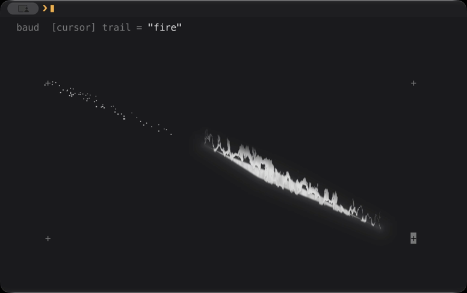
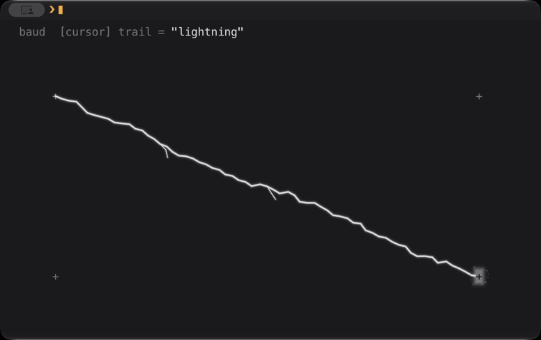
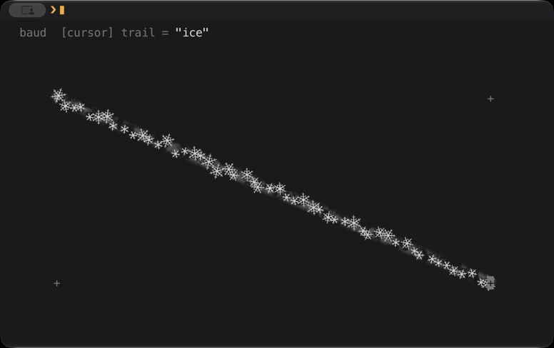
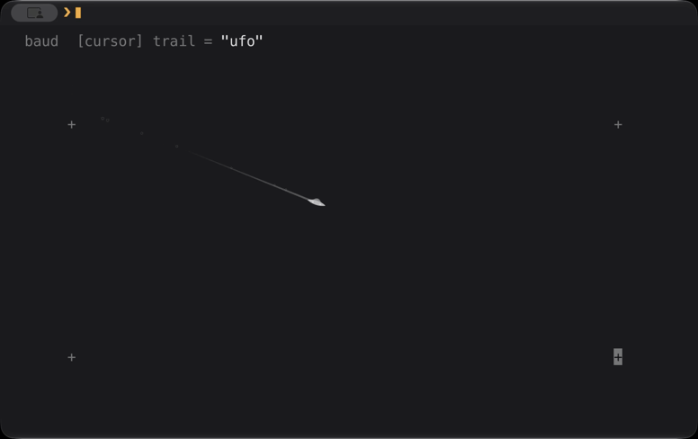
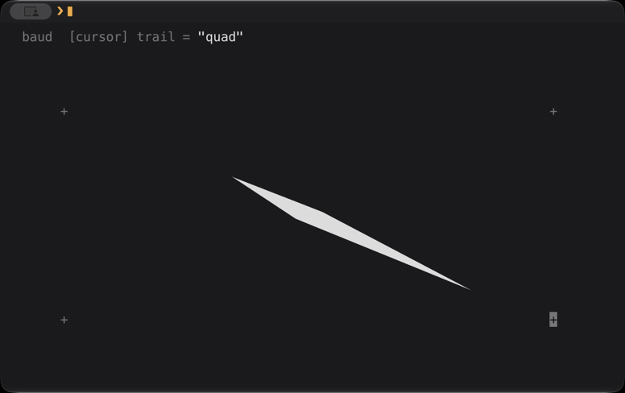
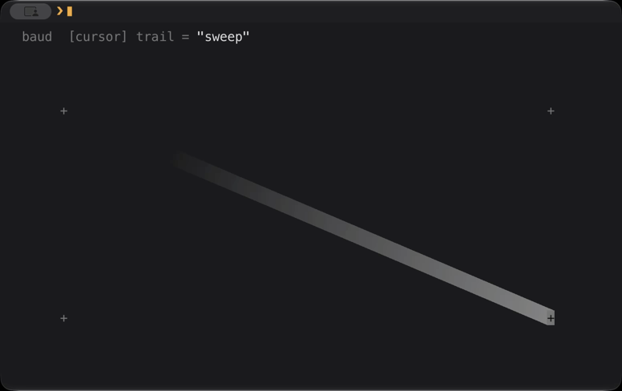

# Cursor trails

A long cursor move leaves a trail, and `[cursor] trail` in the config picks
which. This page shows each one: a still here, and the clips side by side
in [cursor.html](cursor.html), with a speed control and a button that restarts
them together. Open that page in a browser from a checkout; GitHub shows an
HTML file's source rather than the page.

```toml
[cursor]
shape = "block"   # block | underline | bar
blink = "auto"    # auto | true | false
trail = "plasma"  # plasma | fire | lightning | ice | ufo | orb | liquid | quad | sweep | ghost | off
```

`[cursor]` goes after every top-level key: a section header opens a namespace,
and a top-level key below it is read as the section's. `true` reads as the
default, `trail = "plasma"`, and `false` as `trail = "off"`, so a config written
when the key was a switch reads as it did.
[config.toml.example](../config.toml.example) documents every key.

Each still below is the frame of its clip with the most trail on screen, on the
fifth move: the diagonal from the top-left `+` to the bottom-right one, where
the cursor has arrived.

## fire

`trail = "fire"`



A flame rising off the quad below as it collapses onto the cursor. It burns out
from the tail toward the cursor, sheds embers along the path and keeps burning
at the cursor after the corners land: 0.45 to 0.85 s in all, until its last
ember dies. It is the cursor's colour, with heat as opacity, so it is light on
a dark theme and dark on a light one.

A move within a third of a second of the last ignition retargets the quad and
keeps the flame already burning, so a fire lights at most three times a second.
It is drawn on the GPU. The CPU path -- `BAUD_GPU=0`, or a Mac with no Metal
device -- draws the quad alone. Both GPU paths run one shader, so they agree
about any flame, a wrong one included; what holds the shader is a port of the
flame to Rust, which the pixel oracle requires both paths to match to within
one step of 255.

## plasma, the default

`trail = "plasma"`


A faint tube of ionised gas fills the quad as it collapses, with three thin
filaments braided along it and crawling into the cursor, and ions peeling off
the path in tight spirals, half curling one way and half the other. It starves
rather than burns: everything dims together and the filaments thin, over
0.55 s, and the last ion is gone by 0.65 s. Nothing is drawn ahead of the
cursor. It is the cursor's colour, with intensity as opacity.

The braid lies along the move the quad is making, which the driver hands on,
so it follows a retarget and does not turn when the corners land. It is as
wide as the cursor across the move, so a bar or underline cursor narrows it
to one line. GPU only, like the fire, and held to a Rust port of its shader
the same way. The owner chose it as the default on 2026-09-29, over the
fire, which was the default before it; it has shipped as the default since
2026-10-10.

## lightning

`trail = "lightning"`



A thin, jagged bolt thrown from the cell the cursor left to the cell it
reached. It draws itself in from the old cell over 40 ms, like a stepped
leader, holds, and fades over a quarter second, its core thinning as it goes.
Up to three short forks branch off it, a soft corona brightens round the cursor
as it lands, and ten sparks splash from the cursor and fall. It is gone in
0.32 s. Its shape never changes during its life -- no flicker and no re-strike
-- so every pixel it crosses rises once and falls once.

It is not drawn over kitty's quad but over a box along the path, fixed for the
bolt's life, so the chase does not cut its tail off. Because a bolt is out
before the third of a second between ignitions is up, the guard is when the
last one was lit, not whether it still burns: a long move inside that window
throws no second bolt, so it flashes at most three times a second. GPU only;
the CPU path draws kitty's quad.

## ice

`trail = "ice"`



A rime fuse: small six-armed crystals nucleate along the path just behind
kitty's leading corners and grow outward, with a patchy frost haze round them
and a faint pane of ice over the quad as it slides. The lace holds while one
soft glint travels from tail to head, then sublimates tail first -- each
crystal shrinking to its centre -- and sheds hexagonal platelets that pop up
and drift down. Gone by 0.70 s, the last platelet by about 0.87 s.

The frost is laid over the path as well as the quad: a point of the path is
inside kitty's quad for a few tens of milliseconds, too short for a crystal to
grow. Each crystal is one arm folded into six by two mirrors, with side
branches at 60 degrees and a hexagonal plate, turned by a hashed angle. GPU
only, and held to a Rust port of its shader.

## ufo

`trail = "ufo"`



A small flying saucer materialises above the cell the cursor left and swoops
along the path on a gentle arc, banked into its travel, a faint wake behind it
and exhaust rings popping off. It hovers a cell above the cursor with a small
bob -- below it on the top two rows -- lowers a translucent tractor beam onto
it with rings travelling down, then climbs away, shrinking and fading, 0.72 s
after it came. Three to five rim lights crawl round its hull.

Its flight is a spring onto the middle of kitty's quad, so a second long move
re-flies the same saucer without a jump. It is drawn only where the saucer,
the beam and the wake are, not over the quad. GPU only; the CPU path draws the
quad.

## orb

`trail = "orb"`


A glowing sphere in the cursor's colour flies from the cell the cursor left to
the cell it reached, with a soft halo round it and a comet's tail of its last
80 ms behind it. It leaves from rest and lands in the cursor at rest, 0.12 s
after a short move and 0.25 s after a long one. As it lands it bursts into
twelve sparks, and its glow round the cursor fades over a fifth of a second
from 50 ms after. The cursor stays bare, so on a block cursor the sphere shows
as a rim either side of it. The last spark is gone 0.37 to 0.55 s after the
move.

It flies toward the cursor through kitty's quad: the corners facing the move,
which reach the cursor by the time the orb lands. So a second long move
re-flies it without a jump. It was designed for baud rather than taken from
the research, which had no orb. GPU only; the CPU path draws the quad.

## liquid

`trail = "liquid"`


A clear glass gel in the cursor's colour stretches from the cell the cursor
left to the cell it reached: a faint body, a bright rim and a glint that leans
into the move and turns back to the upper left, after macOS's Liquid Glass.
Its back is pulled forward along kitty's quad and it thins in waves. On a long
move it pinches: the back end rounds into a drop, and a thin bridge draws it
into the head, where it merges. Round the cursor the gel swells into a drop
that overhangs the cursor's leading edge by most of a cell; it bulges once
along the move as the back arrives, recoils, and the gel fades. It is gone
about 0.4 s after a 30-column move at the clips' cell. A short hop stretches
and snaps back with no pinch and no bulge, in 0.22 s.

It draws the gel only; it does not bend the text underneath, which would
need a second render pass a frame and still could not bend the wallpaper
behind a glass window. Its back rides kitty's corners along the first move, so
a long move back against it within a third of a second collapses the gel onto
the cursor rather than trailing it. A bar or underline cursor carries the tube
a block does. GPU only; the CPU path draws the quad.

## quad

`trail = "quad"`



kitty's `cursor_trail` [[source: kitty-cursor-trail]]: a quadrilateral whose
four corners each chase the matching corner of the cursor. The corners facing
the move lead, on kitty's 0.1 s constant, and the ones behind it lag, on its
0.4 s one, so the shape stretches along the move and closes onto the cursor,
leaving the cursor's own cell bare [[source: kitty-trail-slang]]. A 30-column
move lasts 0.36 s.

baud computes each corner in closed form rather than stepping it a frame at a
time, so a frame is a function of the time alone, and it freezes each corner's
constant when the move starts where kitty re-picks it every frame. A
horizontal or vertical move is kitty's exactly. A diagonal differs by what the
window's shape does to kitty's numbers, which it computes in normalised device
coordinates.

## sweep

`trail = "sweep"`



sfte's `SFTE_CURSOR_TRAIL` [[source: sfte]]: the cursor's box swept from a tail
that chases it, from none of the cursor's colour at the tail to half of it at
the cursor, hard-edged, with the cursor's own cell bare. The tail closes 1% of
the gap a millisecond, an e-fold of 100 ms, so it is the slowest to fold in: a
30-column move lasts about 0.69 s.

It trails the moves the quad trails. sfte's own rule trails any move made 10 ms
after the one before it, which is a trail behind every keystroke.

## ghost

`trail = "ghost"`


baud's first trail: one cursor-sized box that slides from the cell the cursor
left toward the cell it reached and fades out, in a tenth of a second whatever
the distance. At full speed it reads as a flicker; the page's ¼× shows it.

## What they share

- A move of two cells or fewer snaps, with no trail, so typing leaves none:
  kitty's default, `cursor_trail_start_threshold 2` [[source: kitty-options-definition]].
  A short move while a trail is in flight folds it in on the fast constant, as
  Neovide does [[source: neovide-cursor-renderer]], so the keystrokes after a
  jump do not keep the trail alive.
- The cursor has to rest 10 ms at its new place before a trail follows it, so
  streaming output, which moves the cursor on every read, starts none.
- Hiding the cursor ends a trail and puts a fire out. Looking back into the
  history, a resize, a zoom and a switch between the screens forget where the
  cursor was, so no trail joins two geometries or two screens.
- A hidden cursor that a program moves and then hides straight away is
  followed. That is how helix trails on `gg` and `ge`: it draws its own block
  cursor and hides the terminal's for good, but moves the terminal's cursor to
  the selection before each hide [[source: helix-tui-terminal]].
- Every trail is the cursor's colour: the foreground, unless a program sets
  another with `OSC 12`.
- A trail rides a smooth scroll. When output scrolls the screen under a trail
  in flight, what the trail drew from the path moves up with the text -- a
  move's corners, an effect's whole path, the ghost's start -- and what it drew
  from the cursor stays with the cursor. A move rides two rows at most and then
  folds into the cursor, so a trail does not hang above it while a build log
  streams; an effect's path rides for its whole life. `[cursor] trail_scroll =
  "stay"` keeps the trail where it was drawn.
- An idle terminal pays nothing for any of them. Only a moved cursor starts a
  trail, and one that has ended asks for no more frames.
- Under macOS's Reduce Motion (System Settings, Accessibility, Display) the
  default trail is off. A trail named in the config is kept -- `trail =
  "plasma"` included -- and `trail = true` means the default, so it goes off
  too. Turning the setting on cuts a trail in flight.

## Not built

- **Linux.** The Linux driver reads the key and draws no trail.
- A trail rides only a smooth scroll on the GPU's cell path: under `[scroll]
  mode = "normal"`, on the CPU path and on the alternate screen, the screen
  jumps and the trail stays where it was drawn.
- A trail's particles -- the fire's embers, the lightning's sparks -- are not
  held off the cursor the way its body is, so one can cross it.

## How the clips were made

`scripts/trail-clips.sh` records them, from a release build:

```sh
cargo build --release -p baud-app && scripts/trail-clips.sh
```

For each trail it launches baud at an 80x24 grid with a config of its own --
the built-in fonts at 16 pt (Menlo when the committed clips were recorded;
the embedded JetBrains Mono since it became the default), a
steady block cursor and that trail,
nothing read from `~/.config` -- and runs `scripts/trail-demo.sh` in it, which
makes six moves 1.15 s apart: right, down, left, up, then the two diagonals.
`scripts/trail-record.swift` records baud's window alone through
ScreenCaptureKit at up to 120 frames a second, and `scripts/trail-still.swift`
takes the still from the diagonal.

It checks what it made rather than trusting it. baud has to have read the
config without a complaint, so a clip labelled "quad" cannot be the default
fire. The recorder refuses a window that is not frontmost, a clip with fewer
frames than a trail leaves, and one whose writer dropped more than 1% of the
frames the capture sent. The still has to find at least 20 changed
samples for every trail, and fewer for `off`, which is recorded as the control
and not kept.

The committed clips were recorded with the app as of `e13d1b4`, with the system
in Dark mode and no frame dropped; the theme follows the system's appearance. The capture is baud's
window alone, so the glass shows as flat dark rather than the desktop behind
it.
