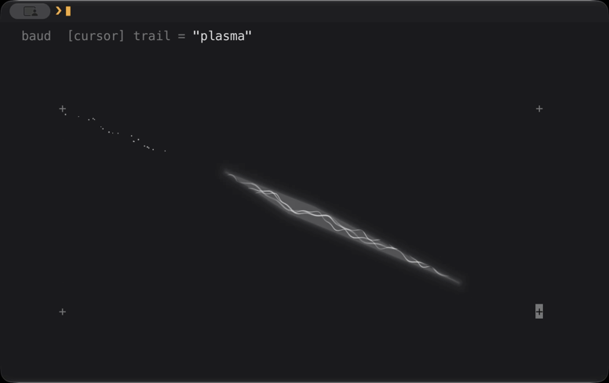
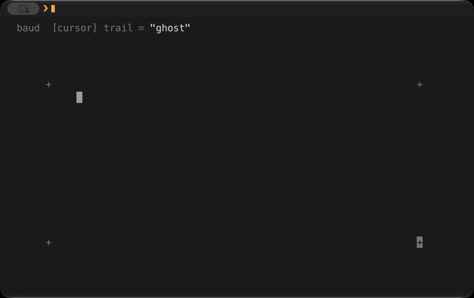

# Cursor trails

A long cursor move leaves a trail, and `[cursor] trail` in the config picks
which. This page shows each one: a still here, and the clips side by side
in [cursor.html](cursor.html), with a speed control and a button that restarts
them together. Open that page in a browser from a checkout; GitHub shows an
HTML file's source rather than the page.

```toml
[cursor]
shape = "block"   # block | underline | bar
blink = true
trail = "fire"    # fire | plasma | quad | sweep | ghost | off
```

`[cursor]` goes after every top-level key: a section header opens a namespace,
and a top-level key below it is read as the section's. `true` reads as the
default, `trail = "fire"`, and `false` as `trail = "off"`, so a config written
when the key was a switch reads as it did.
[config.toml.example](../config.toml.example) documents every key.

Each still below is the frame of its clip with the most trail on screen, on the
fifth move: the diagonal from the top-left `+` to the bottom-right one, where
the cursor has arrived.

## fire, the default

`trail = "fire"`


A flame rising off the quad below as it collapses onto the cursor. It burns out
from the tail toward the cursor, sheds embers along the path and keeps burning
at the cursor after the corners land: 0.45 to 0.85 s in all, until its last
ember dies. It is the cursor's colour, with heat as opacity, so it is light on
a dark theme and dark on a light one.

A move within a third of a second of the last ignition retargets the quad and
keeps the flame already burning, so a fire lights at most three times a second.
It is drawn on the GPU. The CPU path -- `BAUD_GPU=0`, or a Mac with no Metal
device -- draws the quad alone. Both GPU paths run one shader, so they agree
about any flame, a wrong one included; what holds the shader is a port of the
flame to Rust, which the pixel oracle requires both paths to match to within
one step of 255.

## plasma

`trail = "plasma"`



A faint tube of ionised gas fills the quad as it collapses, with three thin
filaments braided along it and crawling into the cursor, and ions peeling off
the path in tight spirals, half curling one way and half the other. It starves
rather than burns: everything dims together and the filaments thin, over
0.55 s, and the last ion is gone by 0.65 s. Nothing is drawn ahead of the
cursor. It is the cursor's colour, with intensity as opacity.

The braid lies along the move the quad is making, which the driver hands on,
so it follows a retarget and does not turn when the corners land. It is as
wide as the cursor across the move, so a bar or underline cursor narrows it
to one line. GPU only, like the fire, and held to a Rust port of its shader
the same way.

## quad

`trail = "quad"`


kitty's `cursor_trail` [[source: kitty-cursor-trail]]: a quadrilateral whose
four corners each chase the matching corner of the cursor. The corners facing
the move lead, on kitty's 0.1 s constant, and the ones behind it lag, on its
0.4 s one, so the shape stretches along the move and closes onto the cursor,
leaving the cursor's own cell bare [[source: kitty-trail-slang]]. A 30-column
move lasts 0.36 s.

baud computes each corner in closed form rather than stepping it a frame at a
time, so a frame is a function of the time alone, and it freezes each corner's
constant when the move starts where kitty re-picks it every frame. A
horizontal or vertical move is kitty's exactly. A diagonal differs by what the
window's shape does to kitty's numbers, which it computes in normalised device
coordinates.

## sweep

`trail = "sweep"`


sfte's `SFTE_CURSOR_TRAIL` [[source: sfte]]: the cursor's box swept from a tail
that chases it, from none of the cursor's colour at the tail to half of it at
the cursor, hard-edged, with the cursor's own cell bare. The tail closes 1% of
the gap a millisecond, an e-fold of 100 ms, so it is the slowest to fold in: a
30-column move lasts about 0.69 s.

It trails the moves the quad trails. sfte's own rule trails any move made 10 ms
after the one before it, which is a trail behind every keystroke.

## ghost

`trail = "ghost"`



baud's first trail: one cursor-sized box that slides from the cell the cursor
left toward the cell it reached and fades out, in a tenth of a second whatever
the distance. At full speed it reads as a flicker; the page's ¼× shows it.

## What they share

- A move of two cells or fewer snaps, with no trail, so typing leaves none:
  kitty's default, `cursor_trail_start_threshold 2` [[source: kitty-options-definition]].
  A short move while a trail is in flight folds it in on the fast constant, as
  Neovide does [[source: neovide-cursor-renderer]], so the keystrokes after a
  jump do not keep the trail alive.
- The cursor has to rest 10 ms at its new place before a trail follows it, so
  streaming output, which moves the cursor on every read, starts none.
- Hiding the cursor ends a trail and puts a fire out. Looking back into the
  history, a resize, a zoom and a switch between the screens forget where the
  cursor was, so no trail joins two geometries or two screens.
- A hidden cursor that a program moves and then hides straight away is
  followed. That is how helix trails on `gg` and `ge`: it draws its own block
  cursor and hides the terminal's for good, but moves the terminal's cursor to
  the selection before each hide [[source: helix-tui-terminal]].
- Every trail is the cursor's colour: the foreground, unless a program sets
  another with `OSC 12`.
- An idle terminal pays nothing for any of them. Only a moved cursor starts a
  trail, and one that has ended asks for no more frames.

## Not built

- **Linux.** The Linux driver reads the key and draws no trail.
- **Ice, liquid, lightning, orb and ufo** are wanted and not built. Each
  starts with reading prior art at source, then a shader in the cursor's colour
  held to a Rust reference the way the fire's is.
- baud does not read macOS's Reduce Motion setting yet, and a trail does not
  ride a smooth scroll.

## How the clips were made

`scripts/trail-clips.sh` records them, from a release build:

```sh
cargo build --release -p baud-app && scripts/trail-clips.sh
```

For each trail it launches baud at an 80x24 grid with a config of its own --
the built-in fonts (Menlo) at 16 pt, a steady block cursor and that trail,
nothing read from `~/.config` -- and runs `scripts/trail-demo.sh` in it, which
makes six moves 1.15 s apart: right, down, left, up, then the two diagonals.
`scripts/trail-record.swift` records baud's window alone through
ScreenCaptureKit at up to 120 frames a second, and `scripts/trail-still.swift`
takes the still from the diagonal.

It checks what it made rather than trusting it. baud has to have read the
config without a complaint, so a clip labelled "quad" cannot be the default
fire. The recorder refuses a window that is not frontmost, and a clip with
fewer frames than a trail leaves. The still has to find at least 20 changed
samples for every trail, and fewer for `off`, which is recorded as the control
and not kept.

The committed clips were recorded with the app as of `8e51cf5`, with the system
in Dark mode; the theme follows the system's appearance. The capture is baud's
window alone, so the glass shows as flat dark rather than the desktop behind
it.
