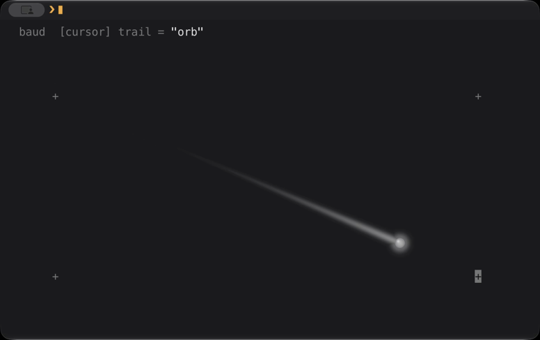
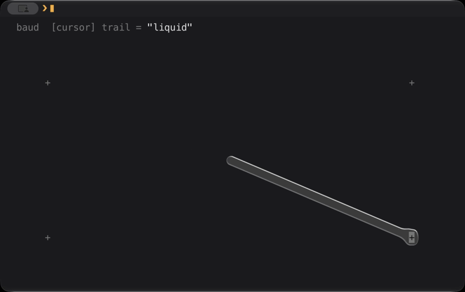

# Cursor trails

A long cursor move leaves a trail, and `[cursor] trail` in the config picks
which. This page shows each one: a still here, and the clips side by side
in [cursor.html](cursor.html), with a speed control and a button that restarts
them together. Open that page in a browser from a checkout; GitHub shows an
HTML file's source rather than the page.

```toml
[cursor]
shape = "block"   # block | underline | bar
blink = "auto"    # auto | true | false
blink_animation = "none"    # none | plasma | fade | fire | ufo
# blink_interval_ms = 250   # each phase; unset follows the system's keys where set
trail = "plasma"  # plasma | fire | lightning | ice | ufo | orb | liquid | quad | sweep | ghost | off
```

`[cursor]` goes after every top-level key: a section header opens a namespace,
and a top-level key below it is read as the section's. `true` reads as the
default, `trail = "plasma"`, and `false` as `trail = "off"`, so a config written
when the key was a switch reads as it did.
[config.toml.example](../config.toml.example) documents every key.

## The cursor's colour

The cursor is baud's amber, the logo's, and so is every trail and blink
animation: `[palette] cursor = "baud"`, the default, over a theme file's
cursor too. The amber is chosen against the page it is drawn on, and the code
computes it (`BaudCursor::on`, `baud-render/src/color.rs`): the logo's
`#F4A32C`, oklch(0.7775 0.155 70.7), where it reads at 4.5:1 against the page,
and elsewhere that amber with its OKLCH lightness alone stepped away from the
page by 0.0001 at a time -- its hue held, as much of its chroma as sRGB keeps,
each step rounded to bytes -- to the first step that reads 4.5:1. That is
WCAG 2.2's ratio for text (1.4.3) [[source: wcag22]], past the 3:1 it asks
of a user interface component (1.4.11), because the prompt's `❯` is text in
the same amber, and `❯` and the block beside it read as one colour, the
logo's `❯█`. The text under a block cursor is the logo's near-black
`#15171B` where it reads 4.5:1 on the amber, and else the page, which reads
on the amber as the amber reads on the page.

| page | cursor | against the page | text under the block | text on the cursor |
|---|---|---|---|---|
| `#101010`, the dark theme's | `#F4A32C`, the logo's | 9.17 | `#15171B` | 8.65 |
| `#EFEFEF`, the light theme's | `#986100` | 4.52 | `#EFEFEF`, the page | 4.52 |
| `#D8D8D8`, the dark theme reversed | `#855400` | 4.51 | `#D8D8D8`, the page | 4.51 |
| `#272727`, the light theme reversed | `#F4A32C` | 7.20 | `#15171B` | 8.65 |

On the light page the logo's `#F4A32C` reads 1.80:1, and the light logo's
earlier `#C8801F` 2.78:1; `#986100` is 2,374 steps down, at L 0.540, chroma
0.116 and hue 71.1, and the step before it, `#996200`, reads 4.49:1. The
light logo files and the launch logo on a light window take `#986100` too,
from the same rule, so light has one amber. The near-black
reads only 3.46:1 on it, so the light theme's text under the block is the
page. **Under reverse video** -- `?5`, and the bell's flash, which draws the
same exchange -- the amber is chosen again against the reversed page, so the
dark theme's block reads 4.51:1 where its own amber would read 1.46:1, and
the trail follows the block. Each ratio is against the page drawn opaque.
**Two places are not held to it**: where the glass lets the desktop through the page, the amber's
contrast with the page depends on the desktop; and an input method's
composition line, drawn over a bar cursor, takes the bar's lowest pixels in
the composition's colour.

A program's cursor colour, `OSC 12`, wins until its reset, `OSC 112`, which
returns to the amber, as xterm returns to its `cursorColor`; the text under
the block stays as it was, as kitty keeps its `cursor_text_color`, and a
program's colour is never chosen again against the page.
`OSC 12 ; ?` answers the amber chosen for the theme's own page.
`"theme"`, asked for by name, draws a theme file's cursor colour and text
where it names them; `"none"`, or a kitty theme's `cursor none` under
`"theme"`, is the classic cursor: the cell's text and background exchanged,
and a trail in the text's colour. A colour set in the config is drawn as set.

Every trail in the amber was counted for WCAG 2.3.1's flashes on the frames
baud's CPU path draws, across a 64 by 20 cell window at 60 frames a second,
one full pass and two repeats at once, on both themes
(`baud-bench/tests/trail_flashes.rs`). Each is under the general and red
flash thresholds on both of the census's readings: the most that flashes
more than three times a second is 24 square points, the light theme's
liquid, of the 21,824 allowed, and 346 on the stricter chained reading. None
makes a red transition: the amber's share of red, R/(R+G+B) on the linear
values, is 0.70 on the dark theme and 0.72 on the light, under the 0.8 of a
saturated red. Fireworks keep their own colours.

The gallery below and the README's film were recorded with the classic
cursor, in the text's colour, and show it until they are recorded again.

A blinking cursor shows for 250 ms and hides for 250 by default, two blinks a
second, and switches plainly: shown, then gone, with nothing drawn between, so
each edge reads as one even beat. `blink_animation` can give the hidden phase
an animation instead: the plasma glow on its cell, a fade out and back in over
30% of the hidden phase each side, the fire -- the cursor burning down into
embers and relighting, in the fire trail's look -- or the ufo -- a saucer's
beam lifting the cursor away and setting it back down, in the ufo trail's.
Reduce Motion, or the Linux desktop's reduced-motion setting once the desktop
has reported it, always means the hard switch. `blink = false` holds the
cursor steady, and `stop_blinking_after` stops it, shown, after a quiet
spell.

Each animation looks the same on every path: the GPU, and the CPU path --
`BAUD_GPU=0`, a Mac with no Metal device, or Linux -- which the pixel oracle
holds to the GPU's pixel for pixel on every animation that draws: the plasma
glow, the fade, the fire and the ufo. The hard switch draws nothing while the
cursor is hidden. Linux draws each animation with the pixels a Mac draws: its
math, like the trails', gives the same bits on macOS and on Linux.

Each still below is the frame of its clip with the most trail on screen, on the
fifth move: the diagonal from the top-left `+` to the bottom-right one, where
the cursor has arrived.

## fire

`trail = "fire"`


A flame rising off the quad below as it collapses onto the cursor. It burns out
from the tail toward the cursor, sheds embers along the path and keeps burning
at the cursor after the corners land: 0.28 to 0.53 s in all, until its last
ember dies. The clip and the still above were recorded at its old, slower
rate, so they show the fire burning longer than it now does. It is the
cursor's colour, with heat as opacity, so it is light on a dark theme and dark
on a light one.

A move within a third of a second of the last ignition retargets the quad and
keeps the flame already burning, so a fire lights at most three times a second.
It looks the same everywhere: on the GPU, on the CPU path -- `BAUD_GPU=0`, a
Mac with no Metal device, or Linux -- and on every OS. The GPU's shader and
the CPU path both follow one Rust model of the flame; the pixel oracle holds
both GPU paths to it within one step of 255 and the CPU path to it exactly,
and its math gives the same bits on macOS and on Linux. Every effect below
-- the plasma, the lightning, the ice, the ufo, the orb and the liquid -- is
drawn and held the same way.

## plasma, the default

`trail = "plasma"`


A faint tube of ionised gas fills the quad as it collapses, with three thin
filaments braided along it and crawling into the cursor, and ions peeling off
the path in tight spirals, half curling one way and half the other. It starves
rather than burns: everything dims together and the filaments thin, over
0.55 s, and the last ion is gone by 0.65 s. Nothing is drawn ahead of the
cursor. It is the cursor's colour, with intensity as opacity.

A move to the left is the move to the right seen in a mirror: the braid
crosses and the ions curl as they do on the way right, mirrored, so a cursor
moved there and back draws the same trail both ways.

Every long move lights a fresh plasma, so a cursor moved back and forth
quickly draws each move as bright as the first. Above a 32 pt cell, a move
back over the same stretch within a second is held under the flash
thresholds of WCAG 2.3.1: its light is clamped at the brightest it can draw
there without a flash, rather than dimmed as a whole, so over a dark page the
tube draws whole and only the brightest filaments are held down.

It is drawn in front of the text. A plasma in the cursor's colour laid over a
letter in that colour cannot change it -- the classic cursor's, the text's --
and it looked as if it passed behind the text. On a dark theme it lights what it
crosses instead (the `screen` blend), and on a light theme it darkens it
(`multiply`): a letter under it brightens, or deepens, with the page around
it, and keeps more of its contrast against the page than it would under the
plain overlay. Over the bare page it looks as it did, within 3 steps of 255,
but where an ion crosses the tube, which it lights by up to 25 steps more (26 of 8,755 lit page pixels at 0.1 s). The launch
splash's plasma and every other trail are drawn as before.

The braid lies along the move the quad is making, which the driver hands on,
so it follows a retarget and does not turn when the corners land. It is as
wide as the cursor across the move, so a bar or underline cursor narrows it
to one line. It became the default on 2026-09-29, over the fire, which
was the default before it; it has shipped as the default since
2026-10-10.

## lightning

`trail = "lightning"`


A thin, jagged bolt thrown from the cell the cursor left to the cell it
reached. It draws itself in from the old cell over 40 ms, like a stepped
leader, holds, and fades over a quarter second, its core thinning as it goes.
Up to three short forks branch off it, a soft corona brightens round the cursor
as it lands, and ten sparks splash from the cursor and fall. It is gone in
0.32 s. Its shape never changes during its life -- no flicker and no re-strike
-- so every pixel it crosses rises once and falls once.

It is not drawn over kitty's quad but over a box along the path, fixed for the
bolt's life, so the chase does not cut its tail off. Because a bolt is out
before the third of a second between ignitions is up, the guard is when the
last one was lit, not whether it still burns: a long move inside that window
throws no second bolt, so it flashes at most three times a second.

## ice

`trail = "ice"`


A rime fuse: small six-armed crystals nucleate along the path just behind
kitty's leading corners and grow outward, with a patchy frost haze round them
and a faint pane of ice over the quad as it slides. The lace holds while one
soft glint travels from tail to head, then sublimates tail first -- each
crystal shrinking to its centre -- and sheds hexagonal platelets that pop up
and drift down. Gone by 0.70 s, the last platelet by about 0.87 s.

The frost is laid over the path as well as the quad: a point of the path is
inside kitty's quad for a few tens of milliseconds, too short for a crystal to
grow. Each crystal is one arm folded into six by two mirrors, with side
branches at 60 degrees and a hexagonal plate, turned by a hashed angle.

## ufo

`trail = "ufo"`


A small flying saucer materialises above the cell the cursor left and swoops
along the path on a gentle arc, banked into its travel, a faint wake behind it
and exhaust rings popping off. It hovers a cell above the cursor with a small
bob -- below it on the top two rows -- lowers a translucent tractor beam onto
it with rings travelling down, then climbs away, shrinking and fading, 0.72 s
after it came. Three to five rim lights crawl round its hull.

Its flight is a spring onto the middle of kitty's quad, so a second long move
re-flies the same saucer without a jump. It is drawn only where the saucer,
the beam and the wake are, not over the quad.

## orb

`trail = "orb"`



A glowing sphere in the cursor's colour flies from the cell the cursor left to
the cell it reached, with a soft halo round it and a comet's tail of its last
80 ms behind it. It leaves from rest and lands in the cursor at rest, 0.12 s
after a short move and 0.25 s after a long one. As it lands it bursts into
twelve sparks, and its glow round the cursor fades over a fifth of a second
from 50 ms after. The cursor stays bare, so on a block cursor the sphere shows
as a rim either side of it. The last spark is gone 0.37 to 0.55 s after the
move.

It flies toward the cursor through kitty's quad: the corners facing the move,
which reach the cursor by the time the orb lands. So a second long move
re-flies it without a jump. It was designed for baud rather than taken from
the research, which had no orb.

## liquid

`trail = "liquid"`



A clear glass gel in the cursor's colour stretches from the cell the cursor
left to the cell it reached: a faint body, a bright rim and a glint that leans
into the move and turns back to the upper left, after macOS's Liquid Glass.
Its back is pulled forward along kitty's quad and it thins in waves. On a long
move it pinches: the back end rounds into a drop, and a thin bridge draws it
into the head, where it merges. Round the cursor the gel swells into a drop
that overhangs the cursor's leading edge by most of a cell; it bulges once
along the move as the back arrives, recoils, and the gel fades. It is gone
about 0.4 s after a 30-column move at the clips' cell. A short hop stretches
and snaps back with no pinch and no bulge, in 0.22 s. A second jump within a
third of a second of the first, while the gel is still there, restarts its
back on that jump, so the gel streams along the second move as it did along
the first rather than collapsing onto the cursor; it lights nothing new, its
opacity carries on, and a gel that had begun to fade is drawn whole again.

It draws the gel only; it does not bend the text underneath, which would
need a second render pass a frame and still could not bend the wallpaper
behind a glass window. Its back rides kitty's corners along the first move, so
a long move back against it within a third of a second collapses the gel onto
the cursor rather than trailing it. A bar or underline cursor carries the tube
a block does.

## quad

`trail = "quad"`


kitty's `cursor_trail` [[source: kitty-cursor-trail]]: a quadrilateral whose
four corners each chase the matching corner of the cursor. The corners facing
the move lead, on kitty's 0.1 s constant, and the ones behind it lag, on its
0.4 s one, so the shape stretches along the move and closes onto the cursor,
leaving the cursor's own cell bare [[source: kitty-trail-slang]]. A 30-column
move lasts 0.36 s.

baud computes each corner in closed form rather than stepping it a frame at a
time, so a frame is a function of the time alone, and it freezes each corner's
constant when the move starts where kitty re-picks it every frame. A
horizontal or vertical move is kitty's exactly. A diagonal differs by what the
window's shape does to kitty's numbers, which it computes in normalised device
coordinates.

## sweep

`trail = "sweep"`


sfte's `SFTE_CURSOR_TRAIL` [[source: sfte]]: the cursor's box swept from a tail
that chases it, from none of the cursor's colour at the tail to half of it at
the cursor, hard-edged, with the cursor's own cell bare. The tail closes 1% of
the gap a millisecond, an e-fold of 100 ms, so it is the slowest to fold in: a
30-column move lasts about 0.69 s.

It trails the moves the quad trails. sfte's own rule trails any move made 10 ms
after the one before it, which is a trail behind every keystroke.

## ghost

`trail = "ghost"`


baud's first trail: one cursor-sized box that slides from the cell the cursor
left toward the cell it reached and fades out, in a tenth of a second whatever
the distance. At full speed it reads as a flicker; the page's ¼× shows it.

## What they share

- A move of two cells or fewer snaps, with no trail, so typing leaves none:
  kitty's default, `cursor_trail_start_threshold 2` [[source: kitty-options-definition]].
  A short move while a trail is in flight folds it in on the fast constant, as
  Neovide does [[source: neovide-cursor-renderer]], so the keystrokes after a
  jump do not keep the trail alive.
- The cursor has to rest 10 ms at its new place before a trail follows it, so
  streaming output, which moves the cursor on every read, starts none.
- When a program hides the cursor, a trail that is drawing fades out over
  0.4 s instead of vanishing, its effect still moving, and comes back at the
  same rate if the cursor is shown again. If the screen kept drawing while
  the cursor was hidden, a trail that starts within 0.4 s of the cursor
  reappearing starts faint and brightens. That is kitty's rule, on the slow
  corner's 0.4 s [[source: kitty-cursor-trail]]; sfte's trail and Neovide's
  animated cursor end at once [[source: sfte]] [[source: neovide-cursor-renderer]].
  Looking back into the history, a resize, a zoom and a switch between the
  screens forget where the cursor was, so no trail joins two geometries or
  two screens.
- A hidden cursor that a program moves and then hides straight away is
  followed. That is how helix trails on `gg` and `ge`: it draws its own block
  cursor and hides the terminal's for good, but moves the terminal's cursor to
  the selection before each hide [[source: helix-tui-terminal]].
- Every trail is the cursor's colour: baud's amber, unless the config, a
  theme file or a program's `OSC 12` sets another, and the foreground under
  the classic cursor.
- A trail rides the scroll. When output scrolls the whole screen under a
  trail in flight, what the trail drew from the path moves up with the text --
  a move's corners, an effect's whole path, the ghost's start -- and what it
  drew from the cursor stays with the cursor. That holds whether the screen
  slides or jumps (`[scroll] mode = "smooth"` or `"normal"`), on the GPU and
  the CPU path, in a full-screen program on the alternate screen and with a
  status line below, on macOS and on Linux. A move rides two rows at most and
  then folds into the cursor, so a trail does not hang above it while a build
  log streams; an effect's path rides for its whole life. A program scrolling
  a region of the screen, such as the text above its own status line, leaves
  the rows under the region where they were, so the trail stays too.
  `[cursor] trail_scroll = "stay"` keeps the trail where it was drawn.
- A program's scroll is not a move. When a program scrolls its text and keeps
  the cursor on its line -- a wheel step in helix, vim or neovim, `zz`, `zt`
  or `Ctrl-E` in vim, the same in a tmux pane -- what the trail holds moves
  with the text, and only what the cursor moved beyond its line trails: a
  cursor that kept its line draws nothing, and every jump still trails. A
  terminal is not told the scroll, so baud reads it off the screen: the
  written lines of the cursor's pane that reappear a few rows up or down, at
  least three of them, the cursor's own line among them. A view moved so far
  that fewer than three of the old lines are left, such as `zb` with the
  cursor on the top line, still trails. Neovide does the same with the
  editor's own scroll [[source: neovide-cursor-renderer]]. Under
  `trail_scroll = "stay"` such a move trails as any other.
- An idle terminal pays nothing for any of them. Only a moved cursor starts a
  trail, and one that has ended asks for no more frames.
- Every trail is drawn on every path: the GPU, and the CPU path --
  `BAUD_GPU=0`, a Mac with no Metal device, or Linux. The quad, the sweep and
  the ghost are the same pixels on both. An effect, the fire to the liquid, is
  one Rust model that the CPU path draws exactly and the GPU follows to within
  one step of 255, so a GPU frame and a CPU frame of it can differ by that
  step on some pixels. The trails' math gives the same bits on macOS and on
  Linux, so Linux draws each trail with the pixels a Mac's CPU path draws.
- Under macOS's Reduce Motion (System Settings, Accessibility, Display), or
  the Linux desktop's reduced-motion setting once the desktop has reported
  it, the default trail is off. A
  trail named in the config is kept -- `trail = "plasma"` included -- and
  `trail = true` means the default, so it goes off too. A named trail fades
  on a hidden cursor as it does under full motion. Turning the setting on
  cuts a trail in flight.

## Not built

- A trail rides output scrolling up, not down: a program scrolling the
  screen down (`SD`, or `RI` on the top row) leaves it where it was drawn.
- A full-screen program on the alternate screen that scrolls more than 75
  lines in one read can leave the trail in the wrong place. The alternate
  screen keeps 150 rows however tall the window is, and the count of the
  lines a read scrolled wraps round them: 76 to 150 lines leave the trail
  where it was drawn, and 151 move it up one row.
- A trail's particles -- the fire's embers, the lightning's sparks -- are not
  held off the cursor the way its body is, so one can cross it.

## How the clips were made

`scripts/trail-clips.sh` records them, from a release build:

```sh
cargo build --release -p baud && scripts/trail-clips.sh
```

For each trail it launches baud at an 80x24 grid with a config of its own --
the built-in fonts at 16 pt (Menlo when the committed clips were recorded;
the embedded JetBrains Mono since it became the default), a
steady block cursor and that trail,
nothing read from `~/.config` -- and runs `scripts/trail-demo.sh` in it, which
makes six moves 1.15 s apart: right, down, left, up, then the two diagonals.
`scripts/trail-record.swift`, in its window form, records baud's window
alone through ScreenCaptureKit at up to 120 frames a second, and
`scripts/trail-still.swift` takes the still from the diagonal.

It checks what it made rather than trusting it. baud has to have read the
config without a complaint, so a clip labelled "quad" cannot be the default
fire. The recorder refuses a window that is not frontmost, a clip with fewer
frames than a trail leaves, and one whose writer dropped more than 1% of the
frames the capture sent. The still has to find at least 20 changed
samples for every trail, and fewer for `off`, which is recorded as the control
and not kept.

The committed clips were recorded with the app as of `9e06507`, with the system
in Dark mode and no frame dropped; the theme follows the system's appearance. The capture is baud's
window alone, so the glass shows as flat dark rather than the desktop behind
it.
