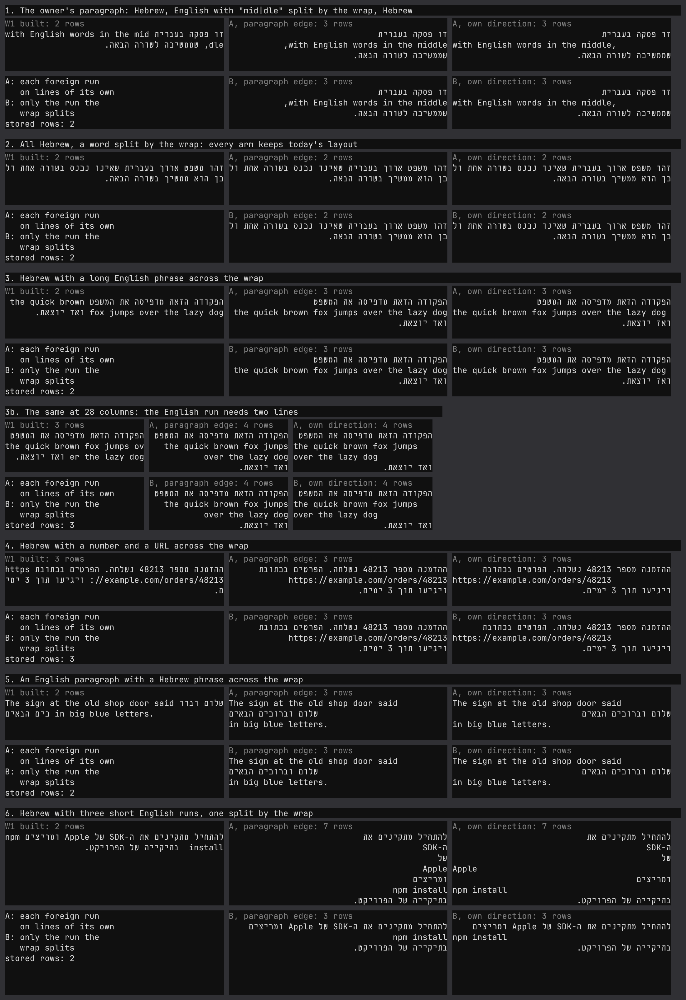
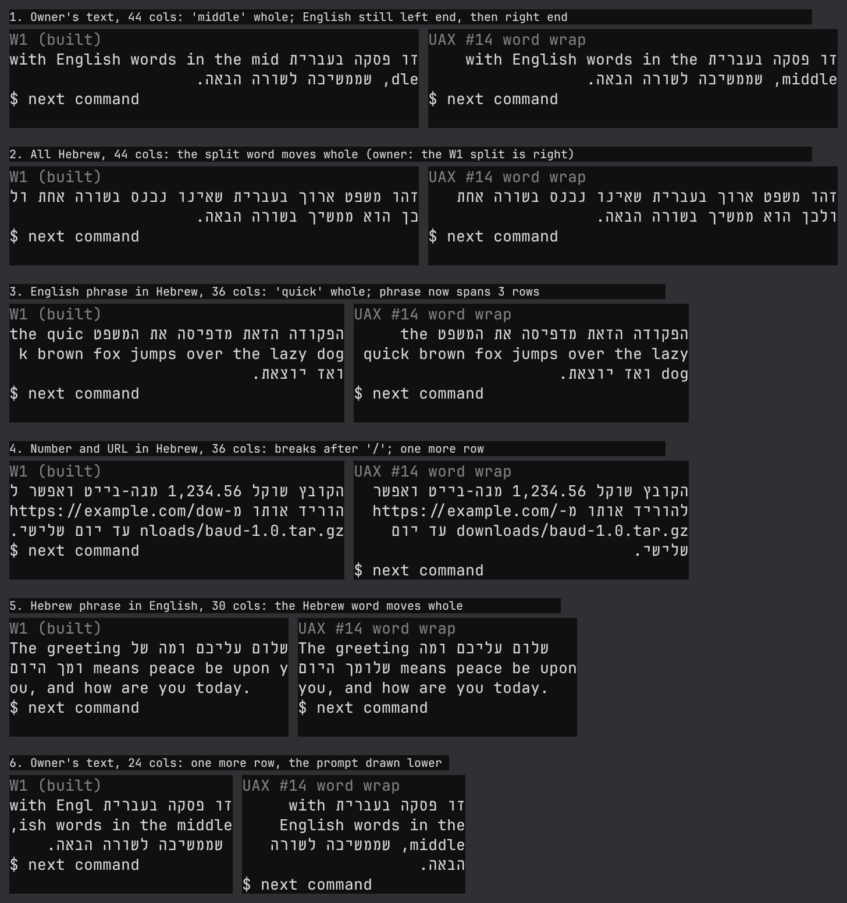
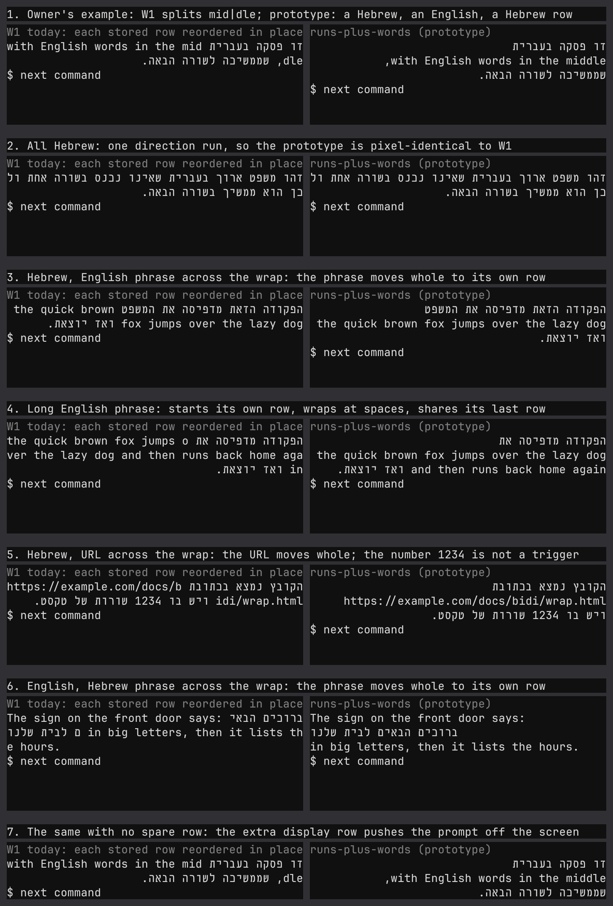

# BD. A right-to-left paragraph that wraps

What a terminal may draw when a paragraph that mixes Hebrew and English
runs past the last column, after all four options of
`ab/b192/wrap.png` were rejected (note AB 12.3). Researched 2026-10-24 from the
governing texts, four layout engines and eight terminals read at source,
baud's own code at `1c8b32b5`, and three prototypes drawn headless by
baud's CPU renderer. Every source below is pinned in
`docs/research/sources/MANIFEST.toml`, group J beside note AB's. Built
2026-10-27 from the choice of the B and own-direction panels, with
every word kept whole, as `[screen] wrap_words` (`docs/bidi.md`, "What you
see"); the prototypes below are as researched.

## 1. What was asked

2026-10-24, on the four options: none of them; a paragraph that goes on to
the next line should be broken into several lines, Hebrew, then English,
then Hebrew; for an all-Hebrew paragraph, example 2's W1, W2 and W3 are
right; and more research, to make the feature excellent.

Read here as two requests:

- **An all-Hebrew paragraph is drawn right today.** Example 2 split
  "ול|כן" mid-word across its two rows, and W1 (built), W2 and W3 all drew
  it the same, and that was accepted.
- **A mixed paragraph that wraps should be drawn as lines of one
  direction each**: a Hebrew line, then an English line, then a Hebrew
  line, instead of an English run split across two rows. In W1 the
  example ends row 1 with "mid" at the left and starts row 2 with
  "dle" at the right (`bd/owner-runs/1-owner.png`, left panel).

Every render in this note draws "זו פסקה" (U+05D6 ZAYIN), the bytes of
the b192 scene that was shown. The embedded font draws ז and ד (U+05D3)
almost alike (section 10), so the first word reads "דו" in every panel.

## 2. What the standards say

**UAX #9 resolves levels over the paragraph and reorders each line after
the paragraph is broken.** Section 3: "first, the text in the paragraph is
broken into lines, then the resolved embedding levels are used to reorder
the text of each line for display". Section 3.4: rules L1-L4 "act on a
per-line basis and are applied after any line wrapping is applied to the
paragraph", and its steps put "The accumulated widths of those glyphs (in
logical order) are used to determine line breaks" before "For each line,
rules L1–L4 are used to reorder the characters on that line". Section
3.5.1: "The process of breaking a paragraph into one or more lines that
fit within particular bounds is outside the scope of the Bidirectional
Algorithm" (`[[source: uax9-bidi]]`; 3.4 and 3.5.1 are unchanged in r52,
`[[source: uax9-tr9-52]]`). So "mid" at the left of row 1 and "dle" at
the right of row 2 is what UAX #9 gives for a break at that point: the
defect is where the line breaks, not the reordering.

**UAX #14 gives break opportunities and leaves the choice among them to
higher-level software.** Section 1: "The selection of actual line break
positions from the set of break opportunities is not covered by the
Unicode Line Breaking Algorithm, but is in the domain of higher level
software". Section 3 allows "an additional prioritization of line breaks
based on aesthetic and other criteria", and an emergency mode where "line
breaks may be placed with no regard to the ordinary line breaking
behavior". Section 3.1: "In bidirectional text, line breaks are
determined before applying rule L1 of the Unicode Bidirectional Algorithm
[UAX9]. However, line breaking is strictly independent of directional
properties of the characters or of any auxiliary information determined
by the application of rules of that algorithm." Section 8.2, Example 2
names the terminal's case: "To implement terminal style line breaks, it
would be necessary to allow breaks at fixed positions. These could occur
inside a run of spaces or in the middle of words without regard to
hyphenation. Such a modification essentially disregards the output of the
line breaking algorithm, and is therefore not a conformant tailoring."
(`[[source: uax14]]` r55, which baud's breaker implements; the same text
in r57, `[[source: uax14-tr14-57]]`.) Rules that decide the examples
here: LB18 breaks after a space; LB28 forbids a break between two letters
of class AL or HL, so "abcשלום" has none; LB13 forbids one before a
comma; LB21a keeps "ה-SDK" whole.

**ECMA-48 leaves a terminal's wrap to the implementation, as implicit
movement of the active position.** 6.1.6, NOTE:
what implicit movement does at the line's end "is not defined by this
Standard" and may "cause a wrap-around movement". 6.1.5: "the coordinates
of the active data position in the data component and of the active
presentation position in the presentation component may differ". 7.2.1,
BDSM IMPLICIT: "Control functions are performed in the data component.
All bi-directional aspects of data are handled by the device itself"
(`[[source: ecma48]]`; searched with `scripts/extract-ecma48.py`, positive
controls passing: "wrap-around" hits twice, "rewrap", "reflow" and
"autowrap" miss). ECMA TR/53 frames a data line and a presentation line
as corresponding (6.1.2-6.1.4, a page of "a predetermined number of
lines"), says that for bi-directionality-unaware applications "the method
of handling the bi-directional data depends on the receiving device"
(7.1), and defines no process that re-breaks a line ("wrap", "reflow", "rewrap"
miss; "presentation component" hits 77 times) (`[[source: ecma-tr53]]`).

**terminal-wg keeps every cell in its row.** "the cells are always
shuffled within a single line ... although how they are shuffled ...
might depend on the contents of the entire paragraph"
(`[[source: terminal-wg-bidi-display-only]]`); trailing erased cells are
skipped "so that each character remains in its row"
(`[[source: terminal-wg-bidi-erased-cells]]`); a paragraph is the rows
between hard newlines (`[[source: terminal-wg-bidi-paragraphs]]`). Its
introduction states the reading rule: "The BiDi algorithm always fills up
the first visual line with as many characters as it can from the
beginning of the logical string ... One’s eyes never have to move upwards
to read the text. Characters are reordered within each line, but not
across lines" (`[[source: terminal-wg-bidi-rtl-text]]`). It calls Emacs's
reorder-then-wrap "contrary to UAX #9" (`[[source:
terminal-wg-bidi-applications]]`) and per-row bidi, W2, wrong: "if an
embedded word of foreign direction happens to cross line boundary, the
entire next line is laid out in opposite base direction" (`[[source:
terminal-wg-bidi-terminals]]`). The only re-layout across rows it
mentions is rewrap on resize, a model operation: "The most user friendly
behavior is to rewrap the lines anyway" (`[[source:
terminal-wg-bidi-misc]]`), after which the look "should only depend on
the current width" (`[[source: terminal-wg-bidi-how-apply]]`). Its review
reads TR/53 as having "No notion of paragraphs" (`[[source:
terminal-wg-bidi-tr53-review]]`), and it requires the algorithm be run
on the entire paragraph (`[[source: terminal-wg-bidi-why-special]]`).

**The request against these texts.** Two axes, kept apart: where a
line breaks (the last column, a UAX #14 opportunity, a change of
direction), and whether the display may move a cell to another row.

- UAX #9 does not forbid it: each drawn line is a contiguous logical
  range reordered by L1-L2 from the paragraph's levels.
- UAX #14 permits the break only where it is an opportunity; the usual
  one is the space between the runs. Choosing breaks *because* the
  direction changes meets 3.1. Read narrowly, as part of "3.1 Determining
  Line Break Opportunities", it binds the opportunities and leaves
  selection to "aesthetic and other criteria"; read broadly, it binds the
  breaks. Both readings are open (section 10).
- terminal-wg is departed from outright: cells leave their stored row,
  and a re-broken paragraph needs as many drawn rows or more, because a
  terminal's wrap already fills every row.

## 3. What layout engines do

All four break the paragraph at UAX #14 opportunities and reorder each
line by itself; none breaks by direction.

- **ICU.** `ubidi_setPara` once per paragraph, the caller's line breaker,
  then `ubidi_setLine` per line: "This is used after calling
  ubidi_setPara() for a piece of text, and after line-breaking on that
  text" (`[[source: icu-ubidi-h-4e68996]]` lines 65-290, 1242-1256;
  opportunities from `[[source: icu-brkiter-h-4e68996]]`).
- **Blink LayoutNG.** Levels over the whole inline formatting context
  (`[[source: blink-inline-node-3a7361d]]` 1323-1343,
  `[[source: blink-bidi-paragraph-3a7361d]]` 36); breaks at
  break-iterator opportunities, by character only for break-all or
  overflow-wrap (`[[source: blink-line-breaker-3a7361d]]` 1453,
  1683-1703, 1760); each line reordered with trailing spaces at the
  paragraph level (`[[source: blink-logical-line-builder-3a7361d]]`
  187-191, 693-760).
- **Pango.** A paragraph itemized with its base direction, lines built
  at UAX #14 opportunities (`can_break_at`), each finished line reordered
  in its post-processing (`[[source: pango-layout-c-8e74c27]]` 3551-3563,
  4908-4939, 6092-6122, 6859-6894).
- **CoreText.** One typesetter per paragraph; `CTTypesetterCreateLine`
  returns a logical range "in the correct visual order";
  `CTTypesetterSuggestLineBreak` and `CTTypesetterSuggestClusterBreak` are
  separate steps, the second offered "to implement a different line
  breaking scheme" (`[[source: coretext-cttypesetter-h]]` 141-280,
  `[[source: coretext-ctline-h]]`).

**CoreText on the example text, measured** (`bd/coretext/ctwrap.out`,
from a headless probe built with Xcode's swiftc; probe source sha256
`4b08277014940c1a43db170227a0689523f5a65409302000713a1d6234e55c61`, not
committed). Hebrew is printed transliterated (ז as Z) so the printout is
not reordered again; 44 columns:

```
(a) a break every 44 cells, as a terminal wraps -- W1's placement
|with English words in the mid JYRBEB HQSP VZ|
|                    .HABH HRVWL HKYWMMW ,dle|
(b) CTTypesetterSuggestLineBreak, a word break
|    with English words in the JYRBEB HQSP VZ|
|                 .HABH HRVWL HKYWMMW ,middle|
(d) a break at each run boundary, moved to the next opportunity
|                              JYRBEB HQSP VZ|
|           ,with English words in the middle|
|                         .HABH HRVWL HKYWMMW|
```

A word break removes "mid|dle" and keeps the placement that was
rejected: the English still ends row 1 at the left and resumes row 2 at
the right. Breaking at the raw run boundary (c, in the file) orphans the
comma that UAX #9 N1/N2 gave the paragraph's level, so it begins the
Hebrew row; moving the boundary to the next opportunity (d) keeps it with
"middle", drawn at the English row's left, after the English as a
right-to-left reader reads it. Rows: 2, 2, 3 and 3 at 44 columns; 4, 4, 5
and 4 at 20.

## 4. What terminals do

No terminal read moves a cell to another row for display.

- **VTE**: "Characters are always shuffled within a line, never across
  lines"; levels over the paragraph, then each row reordered on its own
  (`[[source: vte-bidi-cc-56bad78]]` 19-21, 564, 617-636; `[[source:
  vte-bidi-hh-56bad78]]`). Its resize rewrap is the only operation that
  moves cells between rows: a model operation, "The alternate screen
  should not be rewrapped", and "The cursor should ideally stay over the
  same character" (`[[source: vte-rewrap-txt-0-84]]`, identical at
  56bad78).
- **mlterm**: one screen line at a time (`[[source:
  mlterm-vt-line-bidi-c-46cbbc9]]`, `[[source: mlterm-vt-bidi-c-46cbbc9]]`,
  both identical at 405185a); the swap to visual order maps the cursor
  per row; its vertical mode swaps in a whole visual model by a fixed
  geometric map (`[[source: mlterm-vt-logical-visual-405185a]]` 519-662,
  706-832; `[[source: mlterm-readme-bidi-405185a]]`).
- **Konsole**: the algorithm on one screen line, painted per row
  (`[[source: konsole-terminaldisplay-c8bc143]]` 3477, 3611-3618;
  `[[source: konsole-terminalpainter-a88fae0]]` 336-345, identical at
  c8bc143). Koblinger: "all of PuTTY's, Konsole's, Mlterm's and
  Terminal.app's developers got it wrong and they do BiDi on the physical
  lines" (`[[source: unicode-ml-koblinger-2019-02]]`).
- **iTerm2**: one CTLine over the unwrapped raw line, each wrapped row a
  slice of its visual table (`[[source: iterm2-bidi-display-info-91411f5]]`
  275-293, 937-967; `[[source: iterm2-lineblock-interop-91411f5]]` 59-131;
  `[[source: iterm2-bidi-selection-91411f5]]`). A slice of a whole-line
  L2 order is the slice's own L2 order (argued from L2, not observed), so
  this is W1's placement.
- **WezTerm**: resolved per cluster within one line (`[[source:
  wezterm-cellcluster-cab2516]]` 155-183). **kitty**: no bidi, HarfBuzz
  per buffer (`[[source: kitty-6d5d0c4-options-definition]]` 66-85,
  `[[source: kitty-fonts-c-6d5d0c4]]` 1220-1221). **Windows Terminal**:
  no bidi; "Support Right to Left (RTL) text" open since 2019-05-07
  (`[[source: windows-terminal-issue-538]]`). **mintty**: per line, note
  AB's reading, not re-read.
- **DomTerm**, the one terminal that re-breaks by structure, does so for
  pretty-printing the application asks for; by default it breaks
  mid-word with its own breaker ("we want to line-break in the middle of
  a word ... Hence we need to do the job ourselves") (`[[source:
  domterm-texi-f8f84bc]]` 274-294, 7960-7982; `[[source:
  domterm-terminal-js-f8f84bc]]`; `[[source: domterm-core-css-f8f84bc]]`).

Not read: Terminal.app (closed), Contour, Rio, foot, Alacritty, xterm.js.
So "a Hebrew line, then an English line, then a Hebrew line" has no
precedent in an engine or a terminal, and no terminal has had to keep the
cursor, the selection and program-addressed cells consistent across a
display re-break.

## 5. baud's constraints

**What a program sees does not change.** CPR and DECXCPR come from the
core's position (`baud-core/src/query.rs`, `reported_cursor`); CUP and
every move address stored rows; copy reads logical cells and joins soft
wraps (`baud-render/src/select.rs`); resize reflow re-cuts stored rows
(`baud-domain/src/grid/reflow.rs`). The wrap bit is the top bit of
`RowExtent` (`baud-domain/src/store.rs`), set by DECAWM's wrap and
cleared by LF; a CUP onto a wrapped row and an overwrite leave it set, so
on a full-screen program "joined by a soft wrap" is a heuristic. A
re-break would live in `baud-render`; `baud-core`, its write
amplification and its working set are untouched.

**The frame path is built on one stored row per drawn row.** `Orders`
holds one `RowOrder` per window row (`baud-render/src/bidi.rs`), and each
row's map must be total and stay in its row: `if !reorders ||
out.from.len() != cols { continue; }` (line 742). Every accessor maps
`(Row, Col)` to a column of the same row. Its consumers all index by
window row: the renderer's per-row arrays and pixel bands, the overlay's
cursor and selection mask (`baud-render/src/overlay.rs`), Metal's cursor
slot and smooth scroll's extra rows (`baud-present-macos/src/metal.rs`),
the mouse's inverse map (`baud-app/src/gesture.rs`), the selection's
line-to-row step, the scrollbar and the wheel step
(`baud-render/src/scrollbar.rs`, `baud-app/src/keep.rs`), and row-anchored
images, the status line and an input method's composition.

**A paragraph drawn on more rows than it is stored in adds no height.**
The window keeps `term.rows` rows, so each extra row pushes a stored row
out of view. On the live screen those are rows a program can address, and
everything below the paragraph is drawn off from where the program put
it; `bd/runs-plus-words/7-full.png` shows the prompt pushed off. Keeping
the stored row count does not answer the example: two stored rows
hold three direction runs.

**The existing zone test is not tight enough.** `primary_recuts`
(`baud-core/src/term.rs`) lets reflow run in the Output zone while a
command is still running and can still address rows.

## 6. The three prototypes

Each is a scratch copy of `1c8b32b5` behind a `baud-render` feature that
nothing enables, drawn headless by baud's CPU renderer at 26 px with the
embedded Regular.ttf, with the cursor hidden. Only the CPU draw path was
wired; the cursor, selection, find, links and mouse were not mapped, and
display lines past the window's last row were dropped from the bottom.
The patches are in `bd/`.

### 6.1 owner-runs: the project's idea, two rules by two alignments

`bd/owner-runs/owner-runs.patch`. Re-breaks a paragraph soft-wrapped over
more than one stored row, wholly in the window, not a table row, holding
a foreign run. Levels resolved over the paragraph as today. A run is a
maximal stretch above the paragraph level holding a strong letter of the
other direction, so "48213" and "3 ימים" stay on the Hebrew lines (a BD7
level run would not do: digits in Hebrew are level 2). A run's start
snaps back to the previous UAX #14 opportunity and its end forward to the
next (baud's `line_breaks`, which passes LineBreakTest), so a bracket
goes with the run it encloses and the comma after "middle" with the
English. A piece wider than the window breaks at its last opportunity
that fits. Each line is reordered by L1-L2 from the paragraph's levels.

- **A**: every foreign run gets lines of its own. **B**: only the run the
  terminal's wrap splits does.
- **Paragraph edge**: every line flush to the paragraph's edge, plain
  per-line UAX #9. **Own direction**: a line whose first strong letter
  differs is resolved as a paragraph of its own at its own edge, which is
  W2 for that line.
- A third alignment, flush to the line's own edge with the paragraph's
  order, draws ",with English ... middle" with the comma leading
  (`bd/owner-runs/x-1-owner-own-edge-paragraph-order.png`).

Checks: the all-Hebrew scene is byte-identical (`cmp`) to W1 under all
four arms; every re-broken paragraph draws each non-erased stored cell
once, each display line one contiguous logical range
(`bd/owner-runs/report.txt`). No scene needed a break with no
opportunity, so "abcשלום" was not exercised.

| scene | stored | A | B |
|---|---|---|---|
| 1 owner | 2 | 3 | 3 |
| 2 all Hebrew | 2 | 2 | 2 |
| 3 phrase | 2 | 3 | 3 |
| 3b phrase, 28 columns | 3 | 4 | 4 |
| 4 number and URL | 3 | 3 | 3 |
| 5 English with Hebrew | 2 | 3 | 3 |
| 6 three short English runs | 2 | 7 | 3 |



Scene 6 under A puts "Apple", "ה-SDK" and "של" each on a row of its own
(`bd/owner-runs/6-many.png`); under B, "npm install", the run the wrap
split, gets its row and the others stay inline.

### 6.2 uax14: word wrap alone

`bd/uax14/uax14.patch`. Every soft-wrapped paragraph that passes the
right-to-left gate is re-filled greedily at UAX #14 opportunities, then
each line reordered by L1-L2. Its W1 arm is pixel-identical to the
renders that were shown (b192's three scene files, whose sheet is
`ab/b192/wrap.png`). It removes "mid|dle" and keeps the English at the
left end of row 1 and the right end of row 2 (`bd/uax14/1-owner.png`),
as CoreText's word break does; it moves "ולכן" whole in the all-Hebrew
paragraph (`bd/uax14/2-hebrew.png`), against W1, accepted
there. Across five texts at 16-50 columns, 15 of 90 layouts needed
more rows than stored, at most 2 more.



### 6.3 runs-plus-words: a run the wrap splits starts a line

`bd/runs-plus-words/runs-plus-words.patch`. Two gates: the paragraph
holds a letter of the other direction (digits never count), and the
terminal's wrap falls strictly inside a segment holding one; otherwise
W1. Level runs' starts move forward to the next opportunity; lines fill
greedily, a segment that would be cut starts the next line, and inside a
segment the line ends at its last opportunity or at the cell. A boundary
with no opportunity (LB28) is merged and counted. The first version
re-laid any paragraph with more than one level run, and a Hebrew sentence
holding only a number moved its words at 9 of 10 widths; the second gate
fixed it.

Checks: every stored cell drawn once and in logical order across 6
scenes and 144 sweep layouts, 0 failures (`bd/runs-plus-words/stats.txt`,
`bd/runs-plus-words/sweep.txt`); all-Hebrew, all-English and every
untouched sweep layout pixel-identical to W1. Of the 65 re-laid wrapped
layouts, 23 needed no extra row, 34 one, 7 two, 1 three.



Where it differs from owner-runs B: scene 4 puts the English tail and
"ואז יוצאת." on one shared row (`bd/runs-plus-words/4-long.png`), because
a run's end does not snap to end its line.

## 7. The judge's ranking

Every render was read against the request and the texts.

1. **owner-runs B, paragraph edge, with runs-plus-words' gate and its
   LB28 merge.** It draws the requested shape in scenes 1, 3 and 5, splits
   no word, needs no jump upward, leaves all-Hebrew as W1, and keeps
   UAX #9 whole. The comma drawn at the English row's left is N1/N2's
   level and LB13's no-break, as CoreText draws it. From B: the start
   snaps back, the end snaps forward, so a run ends its own line. From
   runs-plus-words: the wrap-inside-a-foreign-segment gate, the LB28
   merge, and the bijection check over the sweep as the acceptance test.
2. **The same with own-direction alignment.** Reads better to an English
   reader; the line is resolved alone, W2, a UAX #9 departure.
3. **runs-plus-words as built**: the shared tail row of scene 4.
4. **uax14 word wrap**: the placement that was rejected, and all-Hebrew
   changed.
5. **owner-runs A**: 7 rows from 2 in scene 6.

## 8. Recommendation and its scope

Re-break a finished mixed paragraph at its foreign run, as owner-runs B
with paragraph edge draws it, with runs-plus-words' gate; keep W1
everywhere else. **The merged rule was not built or drawn as one**: the
owner-facing panels are owner-runs B's, and they differ from
runs-plus-words only where a run's tail shares a row (6.3).

Scope, set by the rows it adds:

- **The primary screen only.** The alternate screen keeps W1, as VTE
  never rewraps it.
- **Only paragraphs no program can still address.** With shell
  integration, a completed command block (its end mark seen) or lines
  already in history; never the paragraph holding the cursor or live
  input, which stays W1 and switches once when the command ends. Without
  shell integration, W1 on the live screen and the re-break only in
  scrolled-back history.
- **Soft-wrapped, mixed-direction, past the gate**: not a table row, not
  inside DECSLRM margins until `bidi.rs` handles margins.
- **Decided per paragraph, not by window position.** All three
  prototypes fall back to W1 when a paragraph is partly out of the window,
  so its shape would change as it scrolls past the top; the built version
  resolves from history up to a bound, and a paragraph over the bound is
  W1 wherever it sits.
- **Rows**: the cursor and the bottom anchored, the top flowing into
  history, so the scroll position counts display lines.

Whether a run breaking by direction is conforming, and the alignment, are
open (section 10), with one more call.

## 9. What would be built and measured

**Built**, all in `baud-render` and its consumers:

- a two-way map per paragraph, stored `(row, col)` to display
  `(row, col)` and back, with "no cell" for padding and a rule for a
  click on padding; it replaces the per-row total map of `bidi.rs` line
  742 and the same-row fallback of `logical_col`;
- its consumers: the cursor in the renderer, the overlay and Metal; the
  selection mask; find and link runs; the mouse and locator inverse maps,
  which must return a stored row; smooth scroll's extra rows; images
  anchored by row; the status line and the input method;
- one display grid read by all three draw paths, held by
  `right_to_left_rows_draw_in_their_visual_order_on_every_arm`
  (`baud-present-macos/tests/cells.rs`), which the prototypes' CPU-only
  wiring would fail;
- the scroll position, scrollbar and wheel step in display lines;
- the per-row change cache and damage keyed by stored row, since a
  paragraph that grows shifts every row below it.

**Tests**: the bijection over the 144-layout sweep and the scenes; W1
pixel-identity for all-Hebrew, all-English and digits-only paragraphs;
the LB28 merge counted; a paragraph holding the cursor and one on the
alternate screen drawn as W1; mouse reports naming the stored cell.

**Measured**: no prototype ran an A/B. The uax14 timing ran at load
50-57, without the root's release profile, and its 2.5 against 6.7 µs
gap appeared on a scene where the break step never ran, so it is
unexplained and not quoted as a cost. The cost comes from the `frame`
bench's convert column and the app's cell path under the A/B protocol,
with the damage of a paragraph's first re-layout read separately.

## 10. Open

**Open readings:**

1. Moving cells to another row departs from terminal-wg's display-only
   model ("always shuffled within a single line", "each character
   remains in its row"), which `bidi.rs` cites. Against it: UAX #9 3.5.1
   (breaking is out of its scope) and UAX #14 8.2 (fixed-column breaks
   are "not a conformant tailoring"), with ECMA-48 6.1.6 leaving the wrap to
   implicit movement, which stores rows, and W1 UAX #9's result for a
   break at the column.
2. UAX #14 3.1's "strictly independent of directional properties ... or
   of any auxiliary information determined by" UAX #9: narrowly, the
   opportunities only, with selection left to "aesthetic and other
   criteria"; broadly, the breaks. Both the run choice and the gate rest
   on the reading.
3. Own-direction alignment is a per-line P2-P3 departure; paragraph edge
   conforms.

**Open call**: should Hebrew words stay whole inside a re-broken
mixed paragraph while an all-Hebrew paragraph still splits mid-word? Two
rules for one script: compare `bd/owner-runs/2-hebrew.png` with
`bd/owner-runs/1-owner.png` and `bd/owner-runs/3b-narrow.png`. Shown with
it: without shell integration the re-break appears only in scrolled-back
history (`bd/runs-plus-words/7-full.png` is why).

**Found and not fixed.** The embedded font's ז (U+05D6, glyph heb_05D6)
and ד (U+05D3, heb_05D3) are separate glyphs drawn as near-identical
top-bar-over-stem shapes, indistinguishable at 26 px
(`bd/zayin-dalet.png`, drawn at 200 px: ז, ד, ו, ן, ך); the fix
belongs in baud's own Hebrew glyphs in the embedded font. The brief this note was
written from transcribed the word as "דו" from a render.

## 11. The files in bd/

| file | what |
|---|---|
| `owner-runs/sheet.png`, `1-owner.png`, `2-hebrew.png`, `3b-narrow.png`, `6-many.png`, `x-1-owner-own-edge-paragraph-order.png` | W1, A and B by two alignments |
| `owner-runs/captions.txt`, `report.txt`, `owner-runs.patch` | captions; each line's logical range and the checks; the prototype |
| `uax14/sheet.png`, `1-owner.png`, `2-hebrew.png`, `captions.txt`, `uax14.patch` | W1 against word wrap |
| `runs-plus-words/sheet.png`, `1-owner.png`, `4-long.png`, `7-full.png`, `captions.txt`, `stats.txt`, `sweep.txt`, `runs-plus-words.patch` | W1 against runs-plus-words, the sweep, the prototype |
| `coretext/ctwrap.out` | the CoreText probe's printout |
| `zayin-dalet.png` | ז, ד, ו, ן, ך in the embedded font at 200 px |
